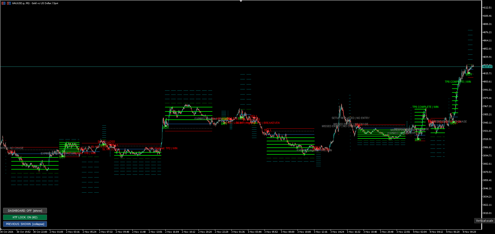

# LegendSniper Reversal

> **Credits: [@TradingLegend](https://x.com/_tradinglegend)**

A swing structure reversal indicator for MetaTrader 5. Detects high-probability reversal setups based on swing highs/lows, plots a full 8-level TP ladder on the chart, and includes an ATR regime filter to separate quality setups from noise.

---

## Features

- Detects swing BUY and SELL setups on any symbol and timeframe
- Plots up to 8 TP levels from entry — lines stay on chart until invalidated
- **Right-scale TP labels** — all 8 targets shown on the price axis at all times
  - ✓ green = already hit, ► cyan = next target, teal = pending
- **OLS dynamic ATR filter** — filters setups outside the normal ATR regime; filtered setups shown dimmed in gray with `[F]` prefix
- **Dashboard panel** — ATR stats, win rate, setup count (toggle on/off)
- **Swing length stats panel** — shows median swing length to help calibrate `InpMult`
- Alerts on new setup and on entry (push notification optional)

---

## Important — MT5 vs TradingView behaviour

This indicator runs on **MetaTrader 5**, which processes events on **candle close**, not on live tick like TradingView.

| Event | MT5 (this indicator) | TradingView |
|---|---|---|
| Swing detected | On bar close after confirmation bars | Live, updates on every tick |
| TP checkmark (✓) | Appears when the bar that touched TP **closes** | Appears the moment price ticks through |
| Setup invalidated | On bar close beyond SL | On tick touch of SL |
| Entry arrow | On bar close that confirms entry trigger | Instant on tick |

**What this means in practice:**

- If price taps TP2 intrabar and then pulls back before the candle closes, the ✓ will **not** appear — the bar did not close at or beyond TP2. The EA/trade however still closes correctly at the actual tick price.
- A setup may look "about to trigger" on the current open bar but the arrow only appears on the **next** bar's open (after the trigger bar closes).
- This is standard MT5 behaviour and is not a bug — it is how all MQL5 indicators work. TradingView users switching to MT5 should expect this delay of one bar on all visual confirmations.

---

## HTF Lock

The **[HTF LOCK]** button in the top-left corner lets you pin the indicator to a **higher timeframe** while staying on a lower timeframe chart.

**Example use case:**  
You are watching XAUUSD on M1 for entry precision. You want the swing structures from M5 displayed — not the noisy M1 structures. Press [HTF LOCK] and the indicator switches to calculating on M5 regardless of which chart timeframe you are on.

**How it works:**
- Set `Lock timeframe` input to the higher timeframe you want (e.g. `PERIOD_M5`, `PERIOD_H1`)
- Or leave it at `PERIOD_CURRENT` and press [HTF LOCK] — it locks to whatever TF the chart is on at that moment
- Press again to unlock and follow the chart timeframe

This is useful when you trade on M1/M2 for entries but want to see structure from M5/M15/H1.

---

## Default Parameters

### HTF Lock / Declutter
| Parameter | Default | Description |
|---|---|---|
| Lock timeframe | `PERIOD_CURRENT` | HTF to lock to — `CURRENT` locks to chart TF at button press |
| Start with history shown | `false` | Previous structures hidden on load |

### Display
| Parameter | Default | Description |
|---|---|---|
| Bars of history | `4000` | How far back to process |
| Show target prices | `true` | Show TP price labels on right scale |
| Show status table | `true` | Show dashboard panel |
| Show EMA | `false` | EMA line on chart |
| Structures in history | `25` | How many past setups to keep when history is ON |

### OLS ATR Filter
| Parameter | Default | Description |
|---|---|---|
| Enable OLS filter | `true` | Filter setups outside ATR regime |
| OLS window (swings) | `50` | Rolling window for regression |
| Band width | `1.5` | Width of ATR band — wider = more setups pass |
| Show filtered setups | `true` | Show filtered setups dimmed in gray |

### Alerts
| Parameter | Default | Description |
|---|---|---|
| Alert on entry | `true` | Alert when BUY/SELL entry triggers |
| Alert on setup | `true` | Alert when new setup is detected |
| Push notification | `false` | Also send to MT5 mobile app |

---

## Install

1. Copy `LegendSniperReversal.ex5` to your MT5 data folder: **File → Open Data Folder → MQL5 → Indicators**
2. Restart MT5 or right-click Navigator → Refresh
3. Drag onto any chart — works on M1 and above

---

