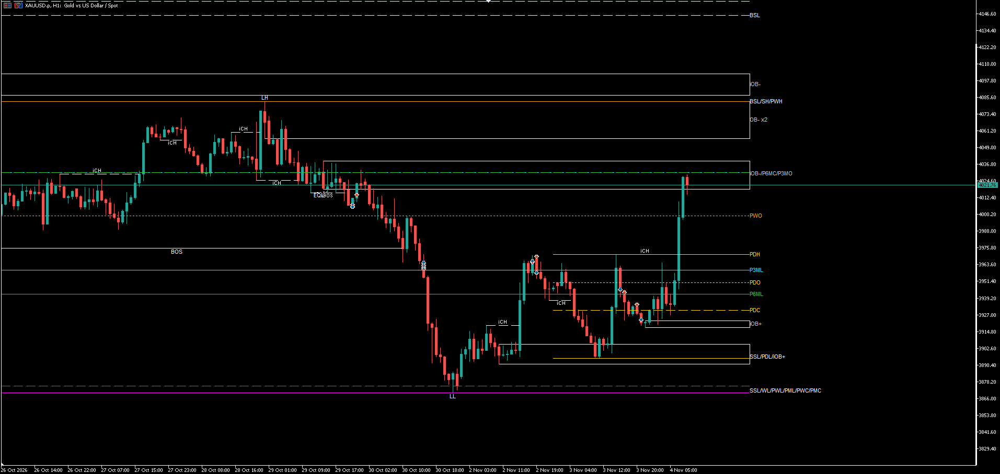

# SMC

Smart Money Concepts indicator for MetaTrader 5. Identifies institutional order flow through structure breaks, order blocks, and liquidity levels.

---

## Features

- **BOS / CHoCH** — Break of Structure and Change of Character on both swing and internal levels
- **Order Blocks** — internal and swing OBs with fill, merge, and ATR volatility filter
- **Equal Highs / Lows** — liquidity resting above/below range
- **Liquidity Pools** — buy-side (BSL) and sell-side (SSL) pools, unswept levels highlighted
- **Previous Period levels** — Day / Week / Month / Quarter / Half-year / Year open, high, low, close
- **Strong / Weak High / Low** labels

---

## HTF Lock (Calculation Timeframe)

The `Calculation timeframe` input (`InpTF`) lets you **pin the indicator to a fixed higher timeframe** regardless of which chart you are on.

**Example use case:**  
You are on M5 watching for entry. Set `InpTF = H1` — the indicator draws H1 order blocks and BOS levels on your M5 chart. You see higher timeframe structure without switching charts.

**How to use:**
- Set `InpTF` to any timeframe: `PERIOD_M15`, `PERIOD_H1`, `PERIOD_H4`, `PERIOD_D1`, etc.
- Set to `PERIOD_CURRENT` to follow the chart timeframe (no lock)
- Default is `PERIOD_H1` — always shows H1 structure regardless of chart TF

This is the same concept as HTF Lock — you trade lower for entries, but see structure from higher up.

---

## Default Parameters

### General
| Parameter | Default | Description |
|---|---|---|
| Calculation timeframe | `H1` | Fixed HTF for all calculations — set to CURRENT to follow chart |
| Bars to analyse | `3000` | History depth on the calculation TF |
| Extend lines/boxes | `15` | Bars to extend active levels to the right |

### Swing Structure
| Parameter | Default | Description |
|---|---|---|
| Show swing BOS/CHoCH | `true` | Major structure breaks |
| Swing length | `50` | Pivot lookback for swing highs/lows |
| Show swing points (HH/HL/LH/LL) | `true` | Label each swing point |
| Show Strong/Weak High/Low | `true` | Mark last broken vs unbroken level |
| Bullish colour | `teal` | |
| Bearish colour | `red` | |

### Internal Structure
| Parameter | Default | Description |
|---|---|---|
| Show internal BOS/CHoCH | `true` | Minor/internal structure breaks |
| Confluence filter | `false` | Only show internal structure confluent with swing |

### Order Blocks
| Parameter | Default | Description |
|---|---|---|
| Internal OBs | `true` | Show internal order blocks |
| Internal OB count | `5` | Max internal OBs to show |
| Swing OBs | `true` | Show swing order blocks |
| Swing OB count | `5` | Max swing OBs to show |
| Volatility filter | `ATR` | Filter weak OBs by ATR size |
| Mitigation source | `High/Low` | What price mitigates an OB |
| Show mitigated OBs | `false` | Keep faded OBs after price fills them |
| Fill OB boxes | `true` | Colour-fill the OB rectangle |
| Merge overlapping OBs | `true` | Combine same-direction overlapping OBs |
| Merge threshold | `0.3` | Overlap share required to merge (0–1) |

### Equal High / Low (Liquidity)
| Parameter | Default | Description |
|---|---|---|
| Show EQH / EQL | `true` | Mark equal highs and lows |
| Bars confirmation | `3` | Pivot confirmation bars |
| Threshold | `0.1 × ATR200` | How close two highs/lows must be to count as equal |

### Liquidity Pools
| Parameter | Default | Description |
|---|---|---|
| Show liquidity pools | `true` | BSL above highs, SSL below lows |
| Pivot strength | `10` | Bars each side for liquidity pivot |
| Max levels per side | `8` | Cap on unswept levels shown |
| Show swept levels | `false` | Show already-swept levels in grey |
| BSL colour | `OrangeRed` | Buy-side liquidity (above market) |
| SSL colour | `DodgerBlue` | Sell-side liquidity (below market) |

### Previous Period Levels
| Parameter | Default | Description |
|---|---|---|
| Previous Day O/H/L/C | `true` | PDO, PDC, PDH, PDL |
| Previous Week O/H/L/C | `true` | PWO, PWC |
| Previous Month O/H/L/C | `true` | PMO, PMC |
| Previous Quarter | `true` | P3MO, P3MC |
| Previous Half-year | `true` | P6MO, P6MC |
| Previous Year | `true` | P12MO, P12MC |

---

## Install

1. Copy `SMC.ex5` to your MT5 data folder: **File → Open Data Folder → MQL5 → Indicators**
2. Restart MT5 or right-click Navigator → Refresh
3. Drag onto any chart
4. Set `Calculation timeframe` to your preferred HTF (e.g. `H1` on an M5 chart)

## Works best on

| Symbol | Chart TF | Calculation TF |
|---|---|---|
| XAUUSD | M5 / M15 | H1 |
| EURUSD / GBPUSD | M5 / M15 | H1 / H4 |
| US30 / NAS100 | M5 | H1 |
| Any | H1 | H4 / D1 |

---

## Included Set File

A ready-to-use settings file `smc.set` is included in this folder. It contains the configuration shown in the preview above — clean monochrome style with key SMC elements active.

**To load it:**
1. Open MT5 → Navigator → Indicators → find `SMC`
2. Drag it onto any chart
3. In the indicator inputs dialog, click the **Load** button (floppy disk icon)
4. Navigate to where you saved `smc.set` and open it
5. Click **OK**

---

> Compiled `.ex5` only — source not included.
